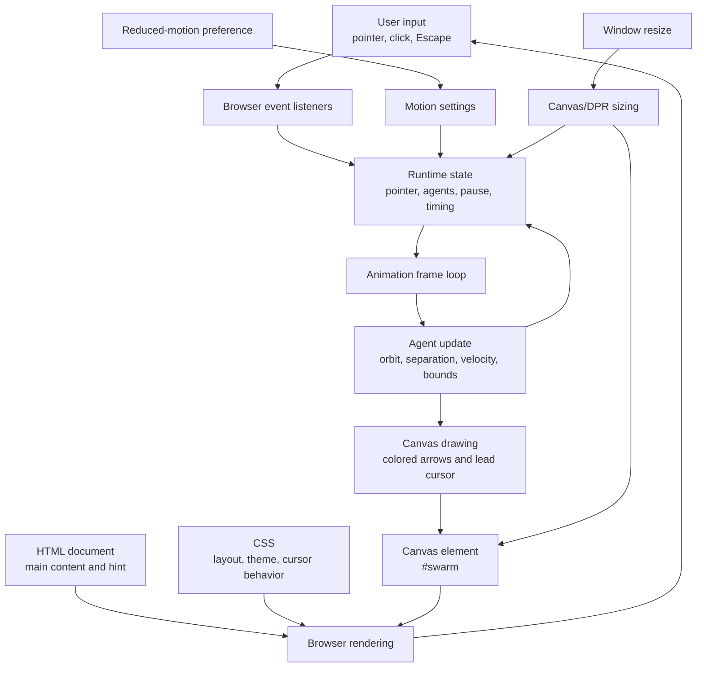

# Architecture Overview

## Runtime flow

- The HTML and CSS provide the page content, dark visual theme, and full-screen canvas.
- The script initializes pointer state and a swarm of agents; reduced-motion preference selects a smaller swarm.
- Pointer and click events update the pointer position, with clicks briefly pushing agents outward. Escape toggles the animation loop.
- Each animation frame updates agent motion (orbit attraction, separation, velocity damping, and edge wrapping), then draws the agents and active pointer on the canvas.
- Resize events update the canvas dimensions and device-pixel-ratio transform. Changes to the reduced-motion preference adjust the cursor presentation.
